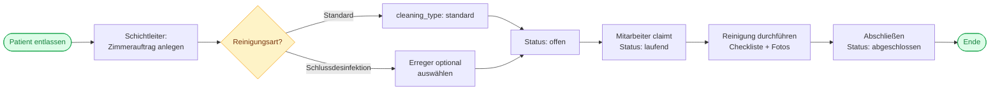

# Prozessdiagramme – OpenClinic

## Hierarchie-Modell

```
Haus ─┬─ Bereich A ─┬─ Station 1 ─┬─ Zimmer 301 ─┬─ Bett A
      │             │             │              └─ Bett B
      │             │             └─ Zimmer 302 ──── Bett A …
      │             └─ Station 2 …
      └─ Bereich B …
                    Aufbereitungsraum (Zentral) ← kein Stations-Scope
```

---

## Prozess 1: Bett-Dezentral

```mermaid
flowchart LR
    start([Patient entlassen]) --> t1[Schichtleiter:\nAuftrag anlegen\nBett auswählen]
    t1 --> t2{Reinigungsart?}
    t2 -- Normal --> t3a[cleaning_type: normal]
    t2 -- Infektiös --> t3b[Erreger auswählen\nMRSA / VRE / …]
    t3a --> t4[Status: offen\nBett: angefordert]
    t3b --> t4
    t4 --> t5[Mitarbeiter:\n'Auf dem Weg'\nStatus: unterwegs]
    t5 --> t6[Mitarbeiter:\n'Angekommen'\nStatus: angekommen]
    t6 --> t7[Barcode scannen\noptional]
    t7 --> t8[Reinigung\nCheckliste + Fotos]
    t8 --> t9[Abschließen\nStatus: abgeschlossen\nBett: frei]
    t9 --> done([Ende])

    classDef decision fill:#fef3c7,stroke:#f59e0b,color:#78350f;
    classDef endNode fill:#dcfce7,stroke:#16a34a,color:#15803d;
    class t2 decision
    class start,done endNode
```



---

## Prozess 2: Bett-Zentral

```mermaid
flowchart LR
    start([Bett angeliefert]) --> t1[Mitarbeiter Zentral:\nAuftrag anlegen]
    t1 --> t2[Barcode erfassen\nPflichtfeld]
    t2 --> t3[Bett-Typ wählen]
    t3 --> t4{ISO-Bett?}
    t4 -- Ja --> t5a[ISO-Flag setzen\nErreger optional]
    t4 -- Nein --> t5b[Weiter]
    t5a --> t6[Aufbereitungsart wählen\nz.B. RKI-Klasse A]
    t5b --> t6
    t6 --> t7[Aufbereitung starten\nStatus: laufend\nkein Transport-Flow]
    t7 --> t8[Anleitung lesen\nAufbereitung durchführen]
    t8 --> t9[Abschließen\nStatus: abgeschlossen]
    t9 --> t10[Reisehistorie:\nStation 'Bettenzentrale']
    t10 --> done([Bett bereit])

    classDef decision fill:#fef3c7,stroke:#f59e0b,color:#78350f;
    classDef endNode fill:#dcfce7,stroke:#16a34a,color:#15803d;
    class t4 decision
    class start,done endNode
```



---

## Prozess 3: Zimmerreinigung



---

## Prioritätslogik (Dezentral)

Stationen werden je Bereich nach einem Prio-Score sortiert:

```
Score = Σ über alle offenen Aufträge:
    1,0 Punkt  pro Auftrag
  + 1,5 Punkte wenn Auftrag älter als 30 Minuten
  (+ Bonus für infektiöse Aufträge – konfigurierbar)
```

Farbschwellen konfigurierbar unter Verwaltung → Einstellungen:
- Grün: Score < `prio_color_yellow`
- Gelb: Score < `prio_color_red`
- Rot: Score ≥ `prio_color_red`
- Rote Umrandung: Station mit höchstem Score je Bereich

---

## Status-Lebenszyklen

### Dezentral / Zimmerreinigung
```
offen → unterwegs → angekommen → laufend → abgeschlossen
```

### Zentral
```
offen → laufend → abgeschlossen
```

### Bett-Status (Dezentral)
```
frei → angefordert → unterwegs → angekommen → in_bearbeitung → frei
```

---

## Bett-Reisehistorie

Ein physisches Bett wird über seinen Barcode (`scanned_barcode` in tasks) identifiziert.

- **Dezentral**: Barcode wird beim aktiven Reinigen gescannt (optional)
- **Zentral**: Barcode ist Pflichtfeld beim Anlegen

In der Reisehistorie erscheinen alle Aufträge chronologisch:
- Dezentrale Aufenthalte: Station + Zimmer + Datum
- Zentrale Aufenthalte: Station = **„Bettenzentrale"** + Datum + Aufbereitungsart

---

## Rollen & Rechte

| Aktion | Reiniger | Schichtleiter | Admin |
|---|:---:|:---:|:---:|
| Eigene Bereiche/Stationen sehen | ✅ | ✅ | ✅ |
| Alle Bereiche sehen | ❌ | ✅* | ✅ |
| Auftrag annehmen / zurückgeben | ✅ | ✅ | ✅ |
| Checkliste & Fotos (eigene Aufträge) | ✅ | ✅ | ✅ |
| Aufträge anlegen | ❌ | ✅ | ✅ |
| Zimmer / Betten verwalten | ❌ | ✅ | ✅ |
| Verwaltung (alle Tabs) | ❌ | ❌ | ✅ |
| Rollen und Permissions bearbeiten | ❌ | ❌ | ✅ |

*Abhängig von zugewiesenen Permissions und Bereichszuweisung
